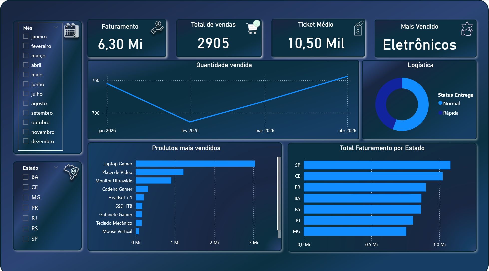
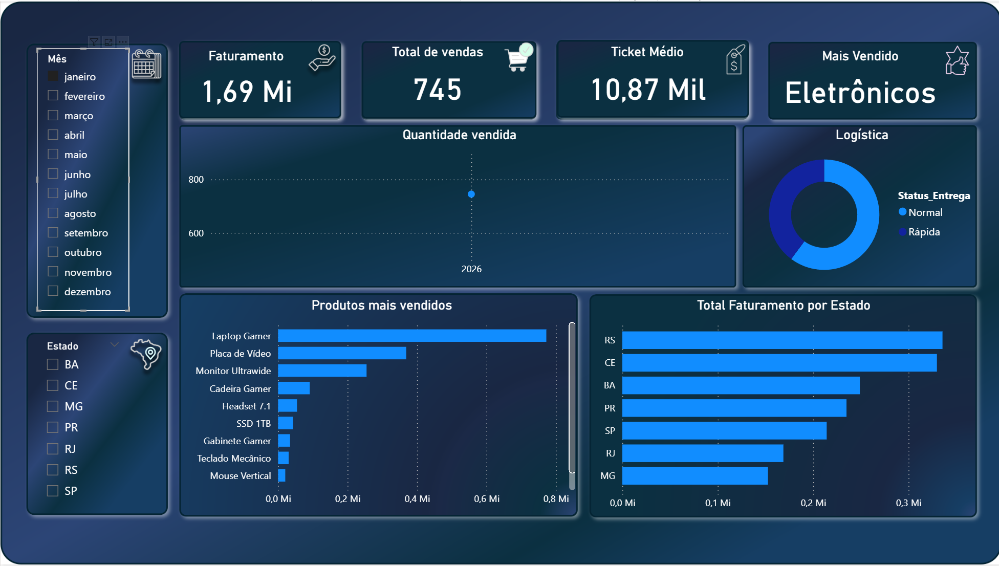
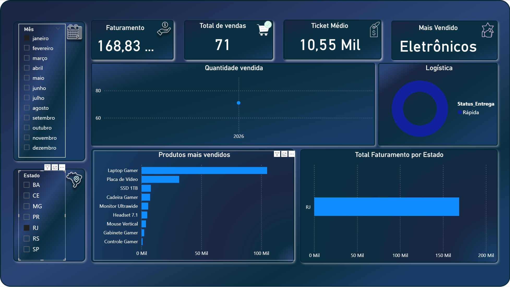

# Dashboard de Performance de Vendas (E-commerce)

Solução de ponta a ponta para análise de vendas: tratamento dos dados brutos com Python e dashboard executivo interativo no Power BI.

## Visão geral

O objetivo foi transformar uma base bruta de vendas em indicadores acionáveis. O projeto foca em KPIs como Faturamento Total, Ticket Médio e performance regional.

## Dados

- **Fonte:** base de estudo, fabricada para exercício. `data/dados_vendas_ecommerce.xlsx` veio de um miniprojeto de estudo e não representa vendas reais de nenhuma empresa.
- **Período:** 01/01/2026 a 30/04/2026 (4 meses).
- **Granularidade:** 1 linha = 1 item de pedido.
- **Volume:** 600 linhas, 12 colunas, 50 clientes, 10 produtos, 4 categorias, 7 estados.
- **Faturamento total:** R$ 6.302.329 (ticket médio de cerca de R$ 10,5 mil).
- **Limitações conhecidas:**
  - Por ser base de exercício, nenhum número aqui descreve o mercado real.
  - "Eletrônicos é a categoria dominante" e "Laptop Gamer no topo" são propriedades de uma base de 600 linhas com 10 produtos, não descobertas de mercado.
  - 4 meses não permitem falar de sazonalidade, tendência ou efeito de campanha.
  - Não há custo, margem, devolução, canal de aquisição nem cliente recorrente: o projeto mede receita bruta e nada além disso.

## Stack

- **Python (Jupyter Notebook):** ETL (extração, transformação e carga).
- **Pandas:** manipulação, limpeza e tratamento dos dados.
- **Power BI:** modelagem visual e medidas em DAX.
- **Excel/CSV:** fonte de dados original.

## Processo de ETL

O tratamento foi feito em Python, e não no Power BI, para garantir a qualidade dos dados antes da visualização:

1. **Limpeza:** remoção de duplicatas e tratamento de valores ausentes.
2. **Tipagem:** conversão de datas e valores numéricos.
3. **Preparação:** geração de uma flat table otimizada para o Power BI.

Código completo em [`notebooks/miniprojeto1.ipynb`](notebooks/miniprojeto1.ipynb).

## Visualização e indicadores

O dashboard usa tema escuro para facilitar a leitura dos KPIs:

- **Faturamento Global:** visão consolidada da receita.
- **Ticket Médio:** valor médio gasto por transação.
- **Ranking de Produtos:** itens mais vendidos.
- **Distribuição Geográfica:** faturamento por estado (destaque para SP e CE).

## Demonstração

Visão geral dos principais indicadores de vendas:



Interatividade e comportamento dos dados sob filtros específicos:





## Estrutura do repositório

```
.
├── data/
│   ├── dados_vendas_ecommerce.csv
│   └── dados_vendas_ecommerce.xlsx   # base de dados utilizada
├── img/                              # prints do dashboard
├── notebooks/
│   └── miniprojeto1.ipynb            # tratamento dos dados em Python
├── pbix/
│   └── vendasDashboard.pbix          # arquivo fonte do Power BI
└── README.md
```

## Autor

**Renato Batista** — Analista de Dados Júnior

- LinkedIn: [renato-santos-dados](https://www.linkedin.com/in/renato-santos-dados/)
- Portfólio: [natoawayrj.github.io](https://natoawayrj.github.io/)
- E-mail: nato_rj@yahoo.com.br
